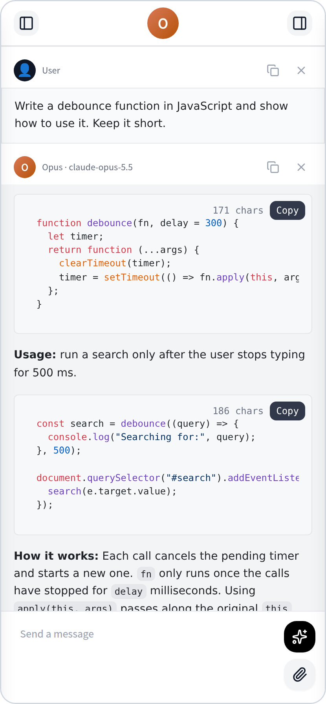
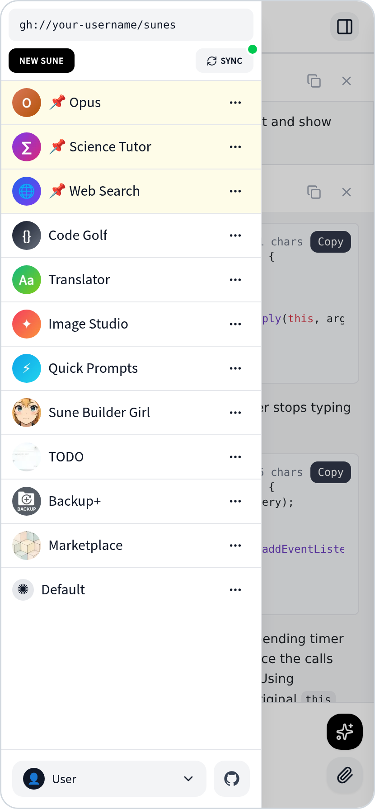
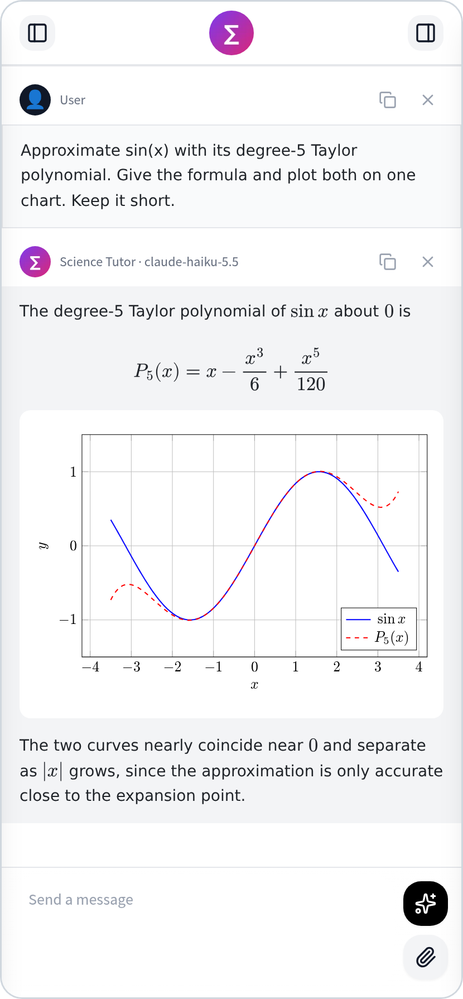
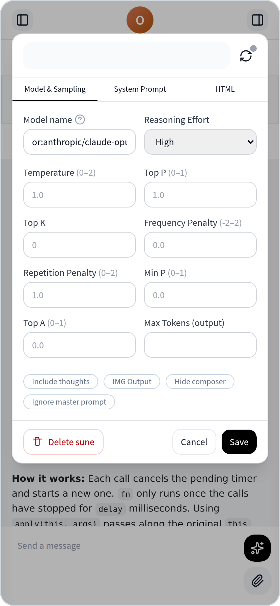
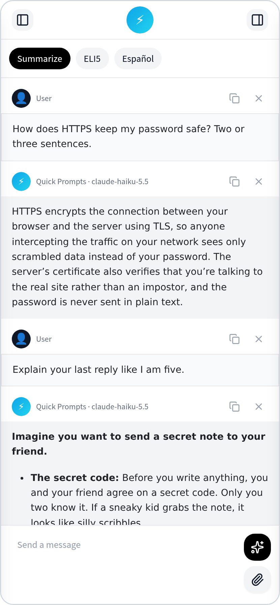
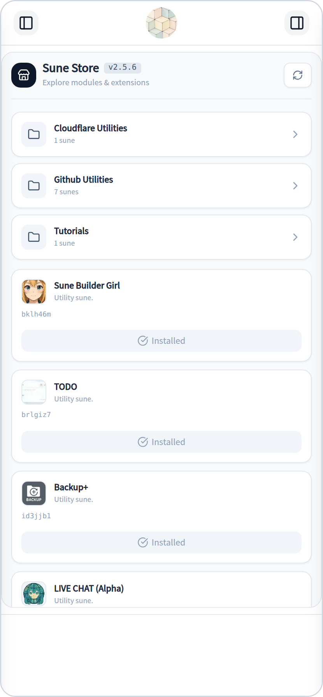
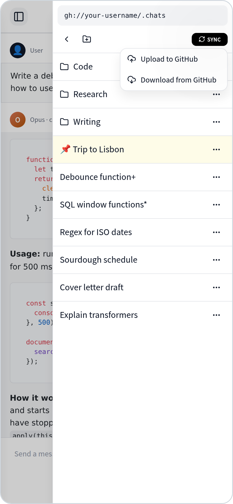
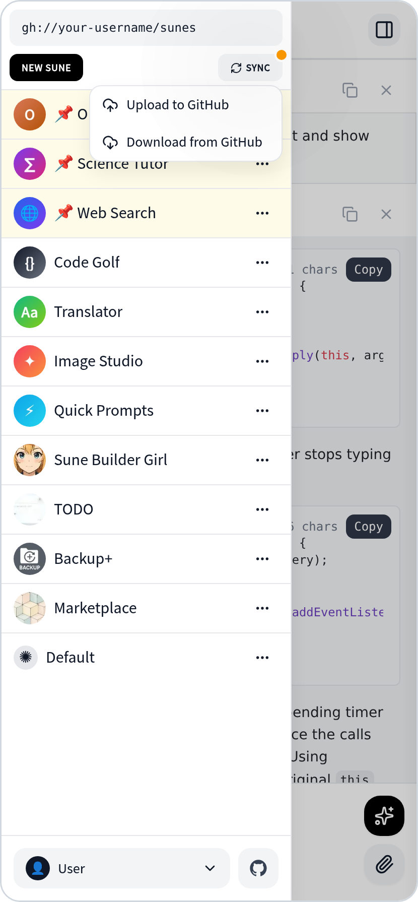

<p align="center"></p>

<h1 align="center">Sune</h1>

<p align="center">
  A chat app for every AI model, in your browser or on your phone.<br>
  Bring your own API key. No account, no tracking, and your chats stay on your device.
</p>

<p align="center">
  <a href="https://sune.planetrenox.com"></a>
  <a href="https://github.com/sune-org/sune/releases/download/v1.1.1/sune-v1.1.1.apk"></a>
</p>

<p align="center">
  
  
  
</p>

## What you get

- **Any model, your key.** OpenRouter, OpenAI, Google and Anthropic keys all work. A prefix on the model name picks the provider, so different sunes can use different ones.
- **Sunes.** Each sune is like a module: a model, its settings, a system prompt, and optionally its own HTML and scripts. You can have many, and share them.
- **Replies that survive.** Lock your phone, switch apps or reload mid-reply. The reply keeps going and is there when you come back.
- **LaTeX and figures.** Math, plots, diagrams, charts, molecules and sheet music are drawn right in the chat.
- **Attachments.** Images, PDFs, audio and video. Video is shrunk on your device before it is sent.
- **Web search, thinking and image generation**, per sune.
- **GitHub sync.** Keep your threads and sunes in a repo you own and pick them up on another device.

## Quick start

1. Open [sune.planetrenox.com](https://sune.planetrenox.com), or install the [Android app](https://github.com/sune-org/sune/releases/latest).
2. Open the left sidebar, then **User → Settings → API**, and paste a key. One [OpenRouter](https://openrouter.ai/keys) key is enough.
3. Tap the round button at the top, set a **Model name**, and save.

Then just chat. The [getting started guide](getting-started.md) walks through each step.

## Guides

Short pages on the things worth knowing.

| Guide | What it covers |
|---|---|
| [Getting started](getting-started.md) | Installing, adding a key, picking a model, finding your way around |
| [Models and providers](models.md) | Model names and prefixes, web search, thinking, sampling, image generation |
| [LaTeX and figures](latex-and-figures.md) | **The prompt to add to your instructions** so models draw plots, diagrams and molecules |
| [Sunes](sunes.md) | Creating, switching, prompts, sharing, the store |
| [Sync and backup](sync.md) | Keeping threads and sunes on GitHub, and what to watch out for |
| [Attachments](attachments.md) | What you can attach and what happens to it |
| [Scripting](scripting.md) | Giving a sune its own interface with HTML and JavaScript, or having a model build it for you |
| [Tips](tips.md) | Regenerating, mixing models in one chat, limits, error messages |

## Sunes

> Each sune is like a module. You can have many. And share them.

A sune holds a model, its sampling settings and a system prompt. Switch sunes to switch model or persona. A sune can also carry HTML and scripts that run on its page, either to give it an interface of its own or to extend the app. More in [Sunes](sunes.md) and [Scripting](scripting.md).

<p align="center">
  
  
  
</p>

The built-in store has ready-made sunes to install, and you can publish your own to [sune-org/store](https://github.com/sune-org/store).

## Sync with GitHub

Threads and sunes live in your browser. To back them up, or to use them on another device, point Sune at a GitHub repo you own. Every thread becomes a JSON file you can browse on GitHub.

<p align="center">
  
  
</p>

Setup takes a few minutes: [Sync and backup](sync.md). Read its warnings first, because sync is manual and GitHub wins when the two disagree.

## Privacy

Sune runs in your browser. Threads, sunes, settings and keys are stored there, not on our servers. Replies are relayed through a small open-source proxy so they keep streaming when your screen locks. It does not log prompts or store keys. The details, including what the proxy can see, are in [Security & Privacy](SECURITY.md).

## Development

```sh
bun install
bun run dev
```

- The app is a static site built with Vite. Cloudflare Pages builds and deploys it on every push to `master`, and builds a preview for any other branch. `dist/` is not committed.
- Replies stream through the [proxy](https://github.com/sune-org/us.proxy.sune.planetrenox.com), which only accepts browser connections from the official site and from GitHub Pages sites (`*.github.io`). A local dev server can't use it. Run your own proxy and point `WS_URL` in [`src/streaming.js`](../src/streaming.js) at it.
- The Android app is a thin wrapper around the website. See [android/README.md](../android/README.md) for releases and how to verify a download.
- LaTeX and figures come from [markdown-it-latex-plus](https://github.com/sune-org/markdown-it-latex-plus).

## License

Free to use for anything, including commercially. If you reuse the code or assets, either mention the project or sponsor it with any amount. The exact terms are in [LICENSE](../LICENSE), and third-party notices are in [THIRD_PARTY_NOTICES.md](../THIRD_PARTY_NOTICES.md).

[](https://starry.direct-img.link)
