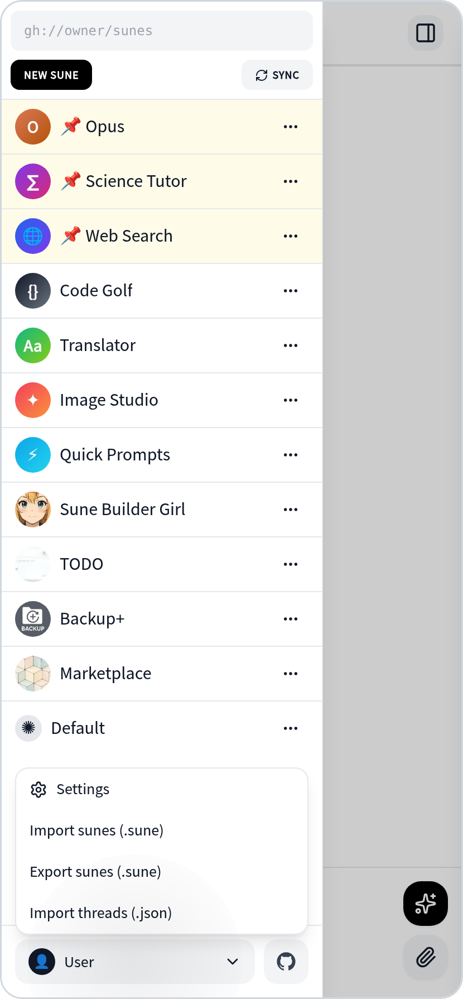
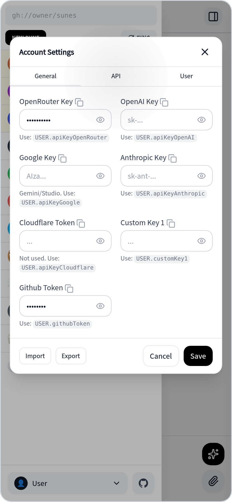

# Getting started

Sune needs two things from you: an API key and a model name. Everything else is optional.

## 1. Open Sune

| Where | How |
|---|---|
| Any browser | Go to [sune.planetrenox.com](https://sune.planetrenox.com) |
| Android | Download the APK from the [latest release](https://github.com/sune-org/sune/releases/latest) |
| Home screen, without the APK | Open the site and choose **Install app** or **Add to Home Screen** in your browser's menu |

All three are the same app. The Android app is a thin wrapper around the website, so new features arrive without updating it.

## 2. Add an API key

Open the left sidebar (top-left button), tap **User**, then **Settings**, then the **API** tab.

  
  

Paste a key for at least one provider and save:

- **OpenRouter** is the easiest start. One key reaches hundreds of models, including free ones. Get it at [openrouter.ai/keys](https://openrouter.ai/keys).
- **OpenAI**, **Google** (AI Studio) and **Anthropic** keys work too, each for that provider's own models.

Keys are saved in your browser only. See [Security & Privacy](SECURITY.md).

If a sune answers *"Tip: open the sidebar → User to set your API key."*, there is no key saved for the provider that sune uses.

## 3. Pick a model

Tap the round button in the middle of the top bar. That opens the settings of the active sune. Type a **Model name** and save.

- New sunes start on `openrouter/free`, which routes to a free model on OpenRouter. It costs nothing but can be slow or rate limited.
- For a specific model, use its slug, for example `anthropic/claude-opus-5.5`.
- The **?** next to the field explains how names work. So does [Models and providers](models.md).

## 4. Chat

Type a message and tap the send button. The paperclip attaches files.

- On a computer, **Enter** sends and **Shift+Enter** starts a new line.
- On a phone, Enter starts a new line. Tap the button to send.
- While a reply is coming in, the send button turns into a stop button.

## Finding your way around

The top bar has three buttons.

| Button | Opens |
|---|---|
| Left | Your **sunes**, and the **User** menu with settings, import and export |
| Middle | Settings of the active sune: model, system prompt, HTML |
| Right | Your **threads**, which is your chat history |

Tapping a sune in the left sidebar starts a new chat with it. Tapping a thread in the right sidebar reopens it.

## Next

- Make models draw plots and diagrams: [LaTeX and figures](latex-and-figures.md). It takes one paste.
- Don't lose your chats: [Sync and backup](sync.md).
- Small things that save time: [Tips](tips.md).
