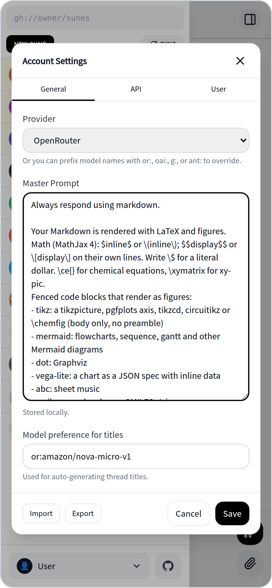
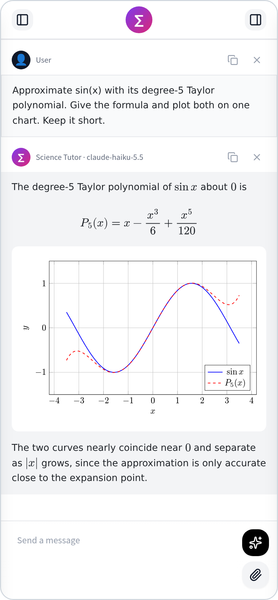
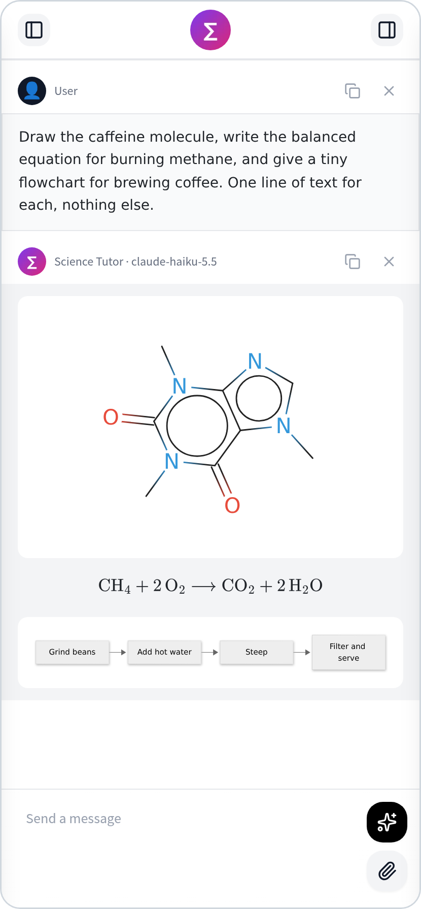

# LaTeX and figures

Sune draws math and figures inside replies: formulas, plots, diagrams, charts, molecules, sheet music. It is powered by [markdown-it-latex-plus](https://github.com/sune-org/markdown-it-latex-plus).

Models write math on their own, but they won't draw a figure unless they know it will be rendered. Tell them once and it works everywhere.

## The prompt to add

Copy this:

```
Your Markdown is rendered with LaTeX and figures.
Math (MathJax 4): $inline$ or \(inline\); $$display$$ or \[display\] on their own lines. Write \$ for a literal dollar. \ce{} for chemical equations, \xymatrix for xy-pic.
Fenced code blocks that render as figures:
- tikz: a tikzpicture, pgfplots axis, tikzcd, circuitikz or \chemfig (body only, no preamble)
- mermaid: flowcharts, sequence, gantt and other Mermaid diagrams
- dot: Graphviz
- vega-lite: a chart as a JSON spec with inline data
- abc: sheet music
- smiles: a molecule as a SMILES string
- svg: raw SVG
```

## Where to put it

**For every sune:** open the left sidebar, then **User → Settings → General**, and add it to the **Master Prompt**, below what is already there. Save.

<p align="center">
  
</p>

**For one sune only:** put it in that sune's **System Prompt** instead.

The master prompt is saved on this device and is not part of GitHub sync. On another device, paste it again, or move your settings over with **Export** and **Import** at the bottom of Account Settings.

## What it looks like

Both replies below are unedited model output with the prompt above in the master prompt.

<p align="center">
  
  
</p>

## What you can ask for

You don't need to name the format. Ask for the thing and the model picks one.

| Ask for | The model writes |
|---|---|
| A formula, derivation or matrix | `$…$` and `$$…$$` math |
| A function plot, bar chart or 3D surface | a `tikz` block with pgfplots |
| A geometry sketch, commutative diagram or circuit | a `tikz` block (TikZ, tikz-cd, circuitikz) |
| A flowchart, sequence diagram, timeline or gantt chart | a `mermaid` block |
| A graph of nodes and edges | a `dot` block (Graphviz) |
| A chart from numbers | a `vega-lite` block |
| A chemical equation | `\ce{…}` inside math |
| A molecule | a `smiles` block, or `\chemfig` in a `tikz` block |
| Sheet music | an `abc` block |
| An icon or simple drawing | an `svg` block |

The [live gallery](https://markdown-it-latex-plus.pages.dev) shows the source next to the result for each of these.

## Good to know

- **The first figure of each kind takes a few seconds.** Its engine is downloaded the first time you need it, then kept. The TikZ engine is the largest, at about 7 MB.
- **A figure appears when its code block is finished.** While the reply is still streaming you see the source.
- **If a figure can't be drawn, its source stays visible** as a code block. Ask the model to fix it, or try a stronger model. Small models make more TikZ mistakes.
- **Prices are safe.** "It costs $5 and $10" is left alone. Models that know the prompt write `\$` when in doubt.
- **Copying a message copies the source**, not a picture. You get the LaTeX or diagram code.
- **Old chats work too.** Rendering happens when a thread is displayed, so earlier replies that contain these blocks are drawn as well.
