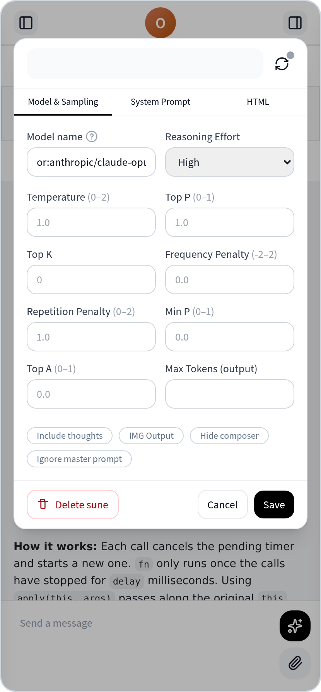
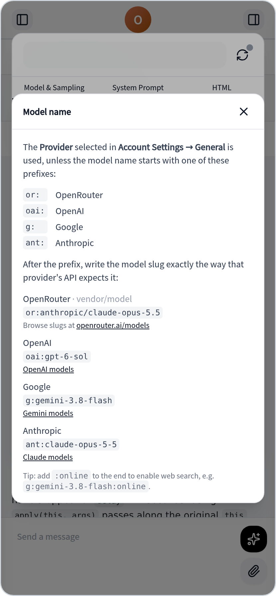

# Models and providers

Every sune has its own model. Tap the round button at the top to open the active sune's settings.

<p align="center">
  
  
</p>

## Model names

A model name is an optional prefix followed by the model's slug, written the way that provider's API expects it.

| Prefix | Provider | Example | Where to find slugs |
|---|---|---|---|
| `or:` | OpenRouter | `or:anthropic/claude-opus-5.5` | [openrouter.ai/models](https://openrouter.ai/models) |
| `oai:` | OpenAI | `oai:gpt-6-sol` | [OpenAI models](https://platform.openai.com/docs/models) |
| `g:` | Google | `g:gemini-3.8-flash` | [Gemini models](https://ai.google.dev/gemini-api/docs/models) |
| `ant:` | Anthropic | `ant:claude-opus-5-5` | [Claude models](https://docs.anthropic.com/en/docs/about-claude/models) |

Without a prefix, Sune uses the **Provider** chosen in **User → Settings → General**, which is OpenRouter unless you change it.

Things worth knowing:

- **Each provider needs its own key** in **User → Settings → API**. A `g:` model with no Google key just answers with the "set your API key" tip.
- **Prefer writing the prefix.** A sune with a prefix keeps working if you change the default provider later, or share the sune with someone whose default is different.
- **Slugs differ between providers.** The same model is `anthropic/claude-opus-5.5` on OpenRouter and `claude-opus-5-5` at Anthropic. If a reply says *Run failed* with a "model not found" style error, the slug is the first thing to check.

## Web search

Add `:online` to the end of the model name:

```
g:gemini-3.8-flash:online
or:anthropic/claude-opus-5.5:online
```

It works with all four providers. With Google and Anthropic keys the reply ends with a list of sources. Providers may charge extra for searches.

## Thinking

- **Reasoning Effort** sets how hard the model thinks: None, Low, Medium or High. *Omitted* leaves it to the provider's default.
- **Include thoughts** shows the model's reasoning above its answer, when the provider returns it. It is off by default.

Not every model supports every level. If a model rejects the setting, set it back to *Omitted*.

## Sampling

Leave a field empty and it is not sent, so the provider's default applies. Only fill in what you want to change.

- **Temperature**, **Top P** and **Max Tokens** work with every provider.
- **Top K**, **Frequency Penalty**, **Repetition Penalty**, **Min P** and **Top A** are only sent through OpenRouter, and only matter for models that support them.

## Image generation

Turn on **IMG Output** in a sune that uses an image model, then choose an aspect ratio and resolution. Images appear in the reply. This works with OpenRouter and Google keys.

Keep a separate sune for it, such as an "Image Studio" sune, rather than toggling it on your everyday one.

## Thread titles

Titles are written by a small model so your main one isn't spent on it. Set it under **User → Settings → General → Model preference for titles**.

- Titles always go through OpenRouter, so they need an OpenRouter key.
- With no OpenRouter key, or with the field cleared, a thread is named after the start of your first message.
- You can rename a thread any time from its **⋯** menu.
