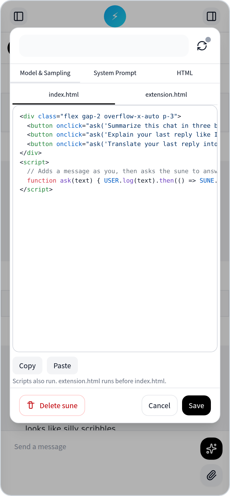
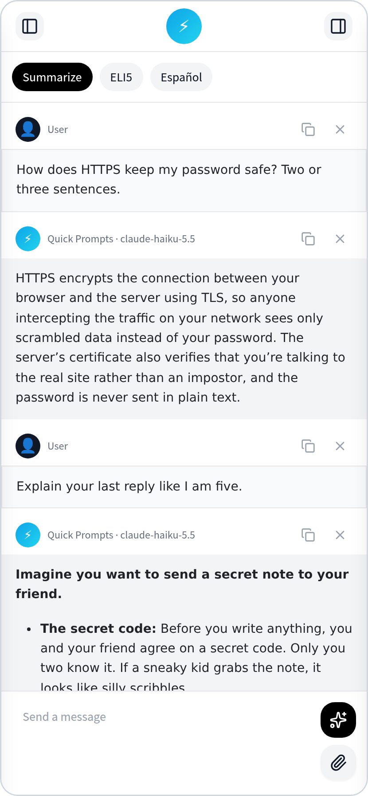

# Scripting

A sune can carry HTML and JavaScript. The HTML is placed at the top of the chat, the scripts run on the page, and both can use everything the app uses. That is enough to add buttons, build a small tool, or change how the app behaves while that sune is active.

<p align="center">
  
  
</p>

You don't have to write it yourself. Install **Sune Builder Girl** from the store, describe what you want, and paste the result into the HTML tab. She is set to a Google model, so change the model name if you use another provider.

## Where the code goes

Open the sune's settings and go to the **HTML** tab. It has two editors:

| Editor | Use it for |
|---|---|
| `index.html` | The sune's own interface and logic |
| `extension.html` | Add-ons. It runs first, and by default holds the extension behind [linking a sune to a file](sunes.md#linking-a-sune-to-a-file-on-github) |

Save, and the HTML appears above the messages.

## A first example

Three buttons that send a canned request:

```html
<div class="flex gap-2 overflow-x-auto p-3">
  <button onclick="ask('Summarize this chat in three bullets.')" class="shrink-0 rounded-full bg-black px-3 py-1.5 text-sm text-white">Summarize</button>
  <button onclick="ask('Explain your last reply like I am five.')" class="shrink-0 rounded-full bg-gray-100 px-3 py-1.5 text-sm">ELI5</button>
  <button onclick="ask('Translate your last reply into Spanish.')" class="shrink-0 rounded-full bg-gray-100 px-3 py-1.5 text-sm">Español</button>
</div>
<script>
  // Adds a message as you, then asks the sune to answer it
  function ask(text) { USER.log(text).then(() => SUNE.infer()) }
</script>
```

## What is already on the page

No imports needed:

- **Tailwind CSS** classes, as in the example above
- **Alpine.js** attributes such as `x-data` and `@click`
- **Lucide** icons: `<i data-lucide="star"></i>`, then call `icons()` if you added them after load
- **cash** as `$`, a small jQuery-style helper
- **localForage**, **highlight.js** and the app's Markdown renderer, `renderMarkdown(element, text)`

## The API

### `SUNE`, the active sune

| Call | What it does |
|---|---|
| `SUNE.name`, `SUNE.model`, `SUNE.system_prompt`, … | Read a setting. Assign to change and save it: `SUNE.temperature = '0.2'` |
| `SUNE.infer()` | Ask the model for a reply to the current chat |
| `SUNE.log(text)` | Add a message as the sune, without calling the model |
| `SUNE.attach(files)` | Add files to the chat as a message from the sune |
| `SUNE.lastReply` | The most recent message from a sune |
| `SUNE.storage` | Saved data for this sune, see below |
| `SUNE.signal` | An `AbortSignal` that fires when the sune is unloaded, see below |
| `SUNE.list`, `SUNE.getByName(name)` | Your other sunes |
| `SUNE.handoff(name)` | Switch to another sune after a few seconds and let it reply. Useful for chains of sunes |

### `USER`

| Call | What it does |
|---|---|
| `USER.log(text)` | Add a message as the user, without sending it to the model |
| `USER.logMany([text, …])` | The same for several messages at once |
| `USER.name` | The user's name |
| `USER.apiKeyOpenRouter`, `USER.customKey1`, `USER.githubToken`, … | The saved keys, for sunes that call an API themselves. **Custom Key 1** in the API settings is a free slot for this |

### The chat

| Name | What it is |
|---|---|
| `state.messages` | The messages of the open chat |
| `partsToText(message)` | The text of one message |
| `THREAD.active` | The open thread: `id`, `title`, … |
| `el` | The app's elements by id, such as `el.composer`, `el.input` and `el.messages` |

### Events

Listen on `el.composer`:

| Event | Fires when | `event.detail` |
|---|---|---|
| `user:send` | The user sends a message | `{ message }` |
| `sune:newSuneResponse` | A reply is finished, or a sune message is added | `{ message }` |

## Saving data

`SUNE.storage` keeps data per sune. It survives reloads, is deleted with the sune, and travels with [sune sync](sync.md#3-sync-your-sunes).

```js
SUNE.storage.set('count', 3)        // any JSON value
SUNE.storage.get('count', 0)        // 3, or the fallback if nothing is saved
SUNE.storage.remove('count')
SUNE.storage.keys()                 // ['count', …]
SUNE.storage.clear()
```

## Cleaning up after yourself

A sune's HTML is loaded again every time you switch to it, open a thread or save its settings, and its scripts run again each time. Anything a script attached outside its own HTML would pile up.

Pass `SUNE.signal` to whatever you set up, and it is removed when the sune is unloaded:

```html
<div class="flex items-center gap-3 p-3">
  <button id="tally" class="rounded-lg bg-black px-3 py-1.5 text-sm text-white"></button>
  <span id="last" class="text-xs text-gray-500"></span>
</div>
<script>
  const btn = document.getElementById('tally'), last = document.getElementById('last')
  const show = () => btn.textContent = 'Replies: ' + SUNE.storage.get('count', 0)
  el.composer.addEventListener('sune:newSuneResponse', e => {
    SUNE.storage.set('count', SUNE.storage.get('count', 0) + 1)
    last.textContent = partsToText(e.detail.message).slice(0, 40)
    show()
  }, { signal: SUNE.signal })
  btn.onclick = () => { SUNE.storage.set('count', 0); show() }
  show()
</script>
```

For things that don't take a signal, such as timers and observers, clean up on abort:

```js
const timer = setInterval(tick, 1000)
SUNE.signal.addEventListener('abort', () => clearInterval(timer))
```

Two more things about scripts:

- `function` and `var` at the top of a script are global, which is why `onclick="ask(…)"` works. `let` and `const` stay inside their script, so running it again doesn't clash.
- Scripts run in order, and an external `<script src>` finishes loading before the next one starts.

## Reusing other sunes

A `<sune>` tag pulls in the HTML of another sune, from a `.sune` file:

```html
<sune src="gh://owner/repo/path/name.sune"></sune>
<sune src="https://example.com/name.sune"></sune>
```

- `gh://` reads from the repo's `main` branch. Use a full URL for anything else.
- The included sune's `extension.html` and `index.html` are both inserted, and its own includes are followed too.
- Add `private` to an include that should only load in your sune itself, and not in sunes that include yours.
- The file is fetched every time the sune loads, so an include always runs the latest version of that file. Include only what you trust.

## Sunes that are tools

Turn on **Hide composer** for a sune that is all interface and no chat, such as a note pad or a to-do list. The store has several to learn from. Their code is in [sune-org/store](https://github.com/sune-org/store).
