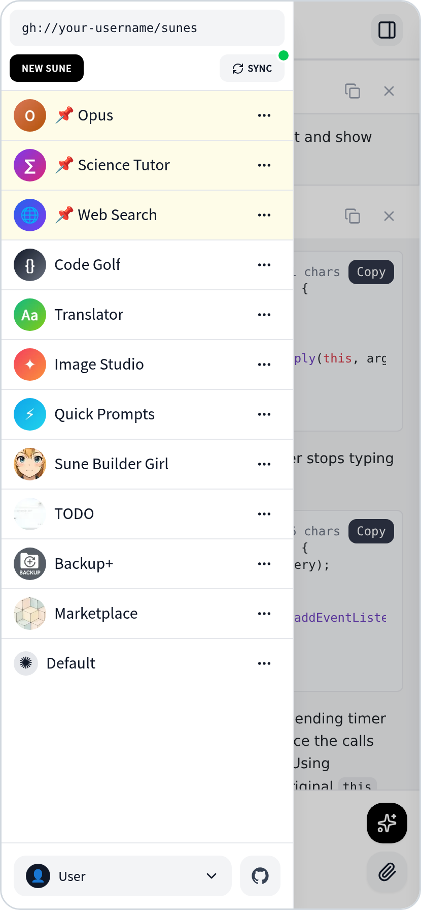
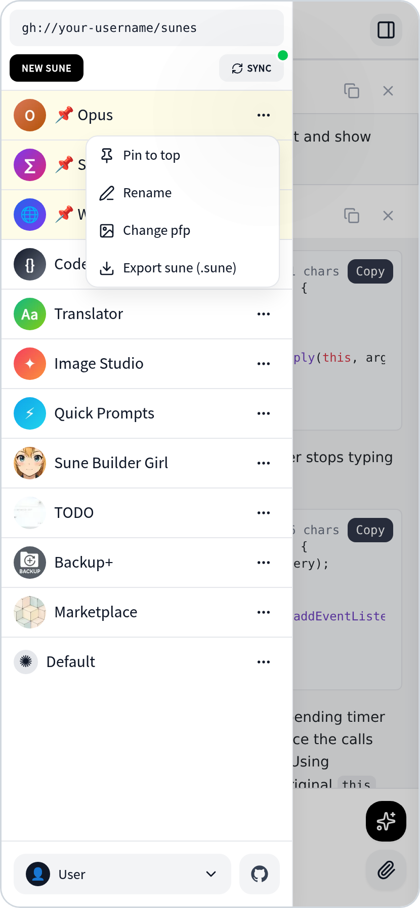
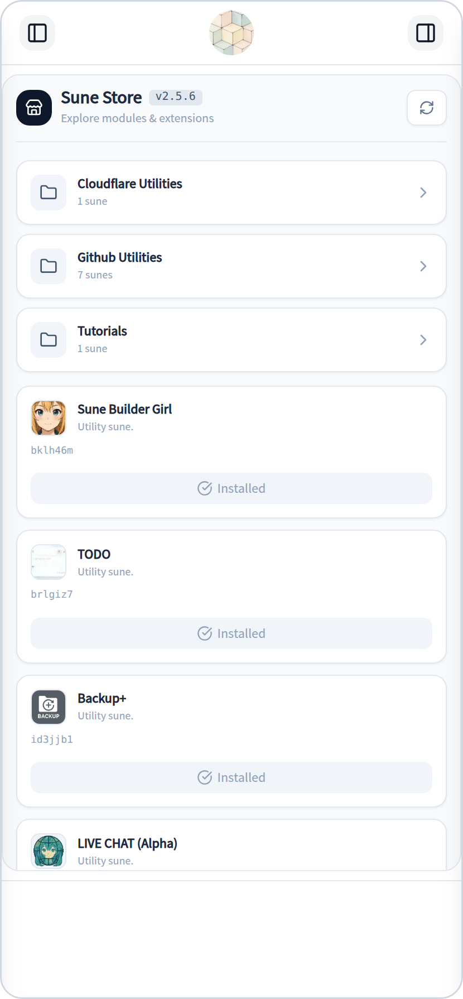

# Sunes

A sune is a saved setup: a model, its sampling settings, a system prompt, a picture, and optionally its own HTML and scripts. Switching sunes is how you switch model or persona.

<p align="center">
  
  
</p>

## The basics

- **Create:** left sidebar → **New Sune**, then give it a name.
- **Switch:** tap a sune in the list. This also starts a new chat.
- **Edit:** tap the round button at the top. It always opens the active sune.
- **Pin, rename, change the picture, export:** the **⋯** next to its name.
- **Delete:** bottom left of the sune's settings.

Tapping any avatar inside a chat also opens the list.

## Settings

The settings have three tabs.

| Tab | What is in it |
|---|---|
| **Model & Sampling** | Model name, reasoning effort, sampling, and the toggles below. See [Models and providers](models.md) |
| **System Prompt** | Instructions for this sune |
| **HTML** | An interface and scripts of its own. See [Scripting](scripting.md) |

The toggles:

- **Include thoughts** shows the model's reasoning in replies.
- **IMG Output** is for image models.
- **Hide composer** removes the message box, for sunes that are tools rather than chats.
- **Ignore master prompt** skips your master prompt for this sune.

## System prompt and master prompt

Two prompts are sent before your messages, in this order:

1. The **Master Prompt** from **User → Settings → General**. It applies to every sune on this device and starts out as *Always respond using markdown.* It is the place for things you always want, like the [LaTeX and figures prompt](latex-and-figures.md).
2. The sune's own **System Prompt**.

Write `{{model_name}}` in a system prompt and it is replaced with the sune's model, without the provider or vendor. With the model `or:anthropic/claude-opus-5.5:online`, *You are {{model_name}}.* becomes *You are claude-opus-5.5.*

## One chat, several sunes

Every reply is labelled with the sune and model that wrote it, and a chat is not tied to one sune. To bring in another:

1. Switch to the other sune. The chat clears.
2. Reopen the thread from the right sidebar.
3. Send your next message. The new sune answers, with the whole conversation as context.

## Sharing and importing

A sune exports as a `.sune` file, which is plain JSON.

- **Export one:** **⋯ → Export sune (.sune)**.
- **Export all:** **User → Export sunes (.sune)**.
- **Import:** **User → Import sunes (.sune)**. New sunes are added. A sune you already have is updated only if the file's copy is newer.

Your API keys are never part of a `.sune` file.

To keep all your sunes on GitHub and in step across devices, see [Sync and backup](sync.md).

## The store

The **Marketplace** sune is always in your list. Open it to browse and install ready-made sunes.

<p align="center">
  
</p>

- A store sune arrives with its author's model. If you have no key for that provider, change the **Model name** after installing.
- Store sunes update themselves. Each one is linked to its file in the store and picks up newer versions on its own. An update also resets changes you made to it, see [below](#linking-a-sune-to-a-file-on-github).
- To publish yours, open a pull request at [sune-org/store](https://github.com/sune-org/store). The store's *Tutorials* folder explains how to run a store of your own.

## Linking a sune to a file on GitHub

The field at the top of a sune's settings links that one sune to a file:

```
gh://owner/repo/path/name.sune
gh://owner/repo@branch/path/name.sune
```

The round-arrow button next to it offers **Upload to GitHub** and **Download from GitHub**, and its dot shows green when the two match and red when they differ.

- Reading from a public repo needs no token. Uploading needs a [GitHub token](sync.md#1-create-a-repo-and-a-token).
- When the file on GitHub is newer than your copy, it is downloaded automatically and **replaces your copy**.
- So if you change a store sune, even just its model, and want to keep that, clear this field. Otherwise the next store update overwrites it.

## Only install sunes you trust

A sune's HTML runs inside the app with the same access you have. It can read your chats and your saved API keys, and it starts running as soon as the sune is active.

Before importing a `.sune` file from outside the official store, open it in a text editor. It is plain JSON, and the code is in its `html` and `extension_html` fields. If you can't read code, paste the file into a chat and ask what it does. A sune with both fields empty is only settings and a prompt.
