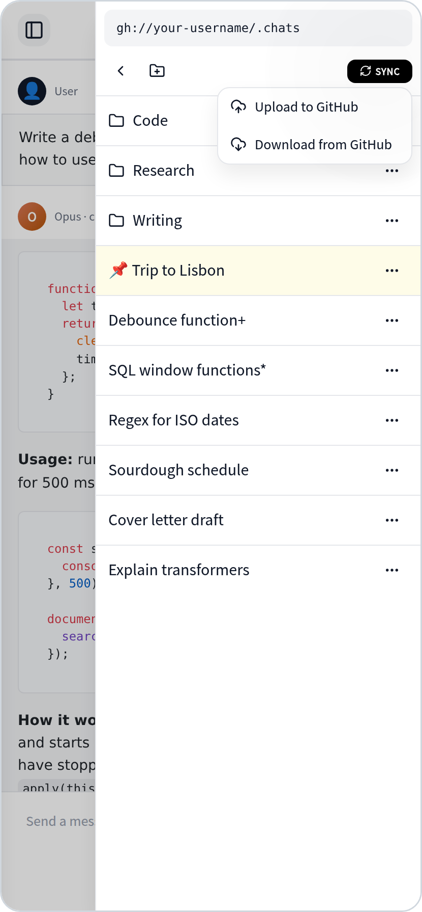
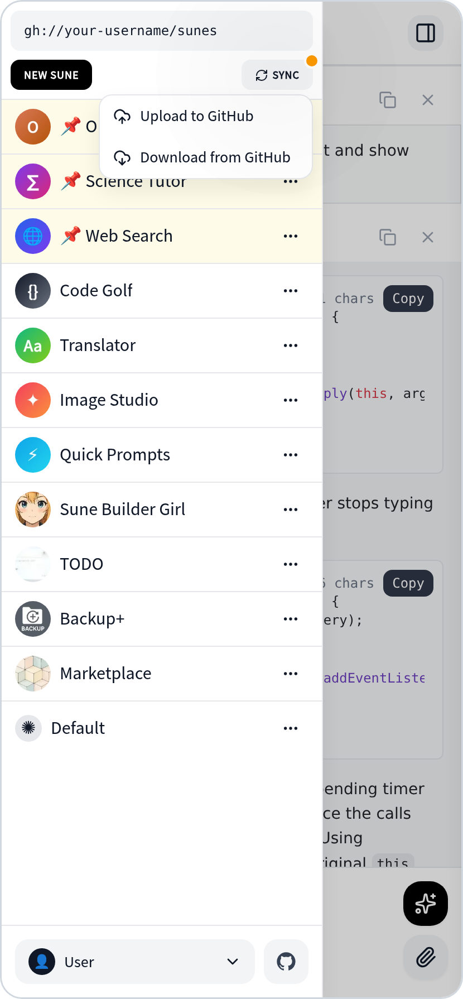

# Sync and backup

Everything in Sune is stored in your browser. Clearing the site's data, or losing the device, loses your chats. GitHub sync puts them in a repo you own, where they also become available on your other devices.

Threads and sunes sync separately, and both are **manual**: nothing is uploaded until you tap **Upload to GitHub**.

## 1. Create a repo and a token

1. **Create a repo on GitHub** for your threads, for example `.chats`. Private is the sensible choice. If you also want to sync sunes, create a second one, for example `.sunes`.
2. **Create a token.** Go to [Fine-grained tokens](https://github.com/settings/personal-access-tokens) → **Generate new token**.
   - Repository access: **Only select repositories**, then pick the repos from step 1.
   - Permissions → Repository permissions → **Contents: Read and write**.
   - A classic token with the `repo` scope also works, but it can reach all your repos.
3. **Give it to Sune.** Left sidebar → **User → Settings → API** → paste it in **Github Token** → **Save**.

## 2. Sync your threads

Open the right sidebar, type your repo into the field at the top and press Enter:

```
gh://your-username/.chats
```

The list now shows what is in that repo. Chat as usual, then tap **Sync**.

<p align="center">
  
</p>

- **Upload to GitHub** sends new and changed threads, and removes the ones you deleted.
- **Download from GitHub** reloads the list from GitHub.
- A `+` after a title means the thread is new and not on GitHub yet. A `*` means it has changes that are not on GitHub yet.

### Read this before you rely on it

- **Upload before you move on.** Once a repo is set, GitHub is the source of truth. Threads marked `+` or `*` are **discarded** whenever the list is reloaded from GitHub. That happens when you tap *Download from GitHub*, open or leave a folder, or change the address in the field. Closing and reopening the app is safe.
- **Threads from before you set a repo are not uploaded.** Local threads and synced threads are two separate lists. Clear the field and your local ones are back. To move one over: **⋯ → Export thread (.json)**, set the repo, **User → Import threads (.json)**, then upload.
- **The branch is assumed to be `main`.** For any other branch write `gh://owner/repo@branch`.
- **Replies that finish while you are elsewhere still count.** A thread that got a reply in the background shows `*` like any other change.

### Folders

- The folder button creates a folder. Tap a folder to open it, and the back arrow to go up.
- A folder exists on GitHub once you upload a thread from inside it. An empty one disappears when the list reloads.
- You can also type a path straight into the field: `gh://your-username/.chats/Work/Clients`.
- Markdown files in the repo are listed too. Tapping one opens it on GitHub.

### On another device

Add the same token and type the same address. The list loads from GitHub and each thread is fetched when you open it. Tap **Download from GitHub** to pick up what another device uploaded since.

### What it looks like on GitHub

Each thread is one JSON file. Its name holds the pinned flag, the time of the last change, an id and the title, so the thread list needs no other index. Attachments are stored inside the thread, so chats with many images or videos make large files and slower syncs.

## 3. Sync your sunes

Open the left sidebar, type a repo into the field at the top and press Enter:

```
gh://your-username/.sunes
```

All your sunes are saved together in one file, `sunes.json`, including the data that scripted sunes have stored.

<p align="center">
  
</p>

The dot on the **Sync** button tells you where you stand:

| Dot | Meaning |
|---|---|
| Green | This device and GitHub match |
| Amber | You have changes that are not uploaded, or nothing is on GitHub yet |
| Blue, pulsing | Checking |
| Red | Something failed. Usually the token or the address |

- **Upload to GitHub** replaces the file on GitHub with this device's sunes.
- **Download from GitHub** replaces this device's sunes with the file.
- **Newer versions arrive on their own.** Sune checks when it starts and each time you open the left sidebar. If the copy on GitHub is newer, it is downloaded and replaces the local one without asking.

It is all or nothing, not a merge, and the last upload wins. Change sunes on one device, upload, then open the sidebar on the other. If you edit on two devices without uploading in between, one set of edits is lost.

To sync a single sune to its own file instead, see [Linking a sune to a file](sunes.md#linking-a-sune-to-a-file-on-github).

## What is not synced

API keys, the GitHub token, your master prompt, default provider, title model, name and picture stay on the device.

To move them, use **Export** and **Import** at the bottom of **User → Settings**. The exported file contains your keys in plain text, so treat it like a password.

## Backups without GitHub

| What | How | File |
|---|---|---|
| One thread | Right sidebar → **⋯ → Export thread (.json)** | `.json` |
| One sune | Left sidebar → **⋯ → Export sune (.sune)** | `.sune` |
| All sunes | **User → Export sunes (.sune)** | `.sune` |
| Account settings and keys | **User → Settings → Export** | `.json` |

Import them again from the **User** menu.

## When sync fails

Uploads report errors. Downloads and opening a repo fail quietly, so if the list stays empty or unchanged, check the same things.

| Message | Likely cause |
|---|---|
| `No GH token` | No token saved under **User → Settings → API** |
| `GH API 401` | The token is wrong or expired |
| `GH API 403` | The token has no write access to this repo, or GitHub is rate limiting you |
| The list is empty | Wrong owner, repo or branch, or the token can't see the repo |
