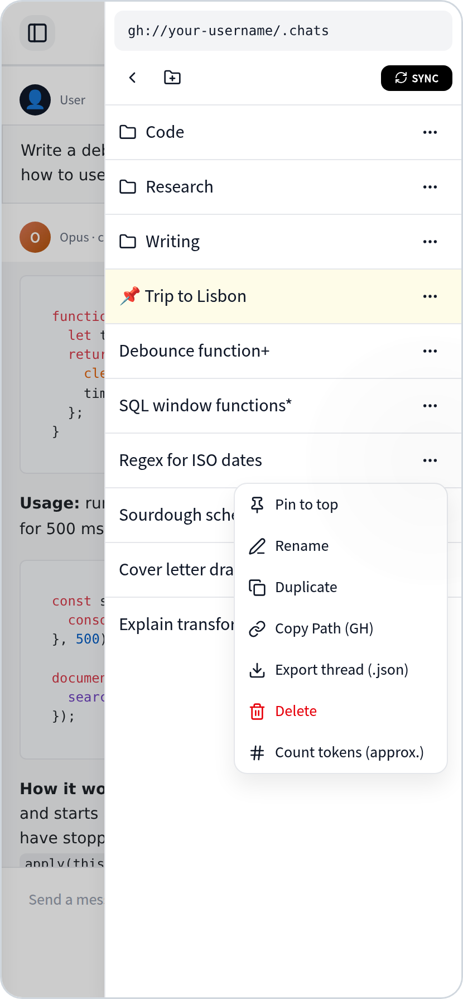

# Tips

Small things that are easy to miss.

## Chatting

- **Regenerate a reply:** delete it with the **×** above it, then tap send with the message box empty. Sending with an empty box always asks the model for another reply to the chat as it stands.
- **Edit history:** every message has its own **×**. Remove a wrong turn and carry on from there. The model only sees what is still in the chat.
- **Branch a chat:** right sidebar → **⋯ → Duplicate**, then continue the copy in a different direction.
- **Stop a reply:** the send button becomes a stop button while a reply is coming in. What arrived so far is kept.
- **Start a new chat:** tap a sune in the left sidebar. Tapping the one you are already using works too.
- **Mix models in one chat:** switch sune, reopen the thread from the right sidebar, and keep going. Each reply shows which sune and model wrote it. See [Sunes](sunes.md#one-chat-several-sunes).
- **Enter or Shift+Enter:** on a computer, Enter sends and Shift+Enter starts a new line. On a phone, Enter starts a new line.
- **Copy:** the copy icon above a message copies the whole message as Markdown. Every code block has its own **Copy** button, next to its length in characters.

## Replies keep going without you

A reply runs on the server, not in your browser tab. You can lock your phone, switch apps, open another thread or close Sune, and it carries on.

- Start replies in several threads and let them run side by side.
- Come back within **90 minutes** of a reply finishing and it is picked up where you left it. After that the rest is gone, and the message says so.
- A single reply can run for **12 minutes** at most.

## Threads

  

- **Pin to top** keeps a thread above the rest.
- **Count tokens** estimates how large a chat has become, at about four characters per token. Long chats cost more with every message, because the whole chat is sent each time.
- **Export thread (.json)** saves one chat to a file. **User → Import threads (.json)** brings it back.
- **Copy Path (GH)** copies a synced thread's location on GitHub.
- Titles are written automatically by a small model. See [Thread titles](models.md#thread-titles) to change or switch that off.

## Prompts

- **Put standing instructions in the Master Prompt** under **User → Settings → General**. It goes to every sune, which makes it the right place for the [LaTeX and figures prompt](latex-and-figures.md).
- **`{{model_name}}`** in a system prompt becomes the name of the sune's model. Handy when one prompt is shared by sunes on different models.
- **A sune that should ignore your master prompt** has a toggle for it: **Ignore master prompt**.

## Looking after your data

- **Everything is in your browser.** Clearing site data deletes your chats, sunes and keys. Set up [sync](sync.md), or export now and then.
- **With GitHub sync, upload before you switch folders.** Threads marked `+` or `*` are not on GitHub yet and are dropped when the list reloads. The [sync guide](sync.md#read-this-before-you-rely-on-it) explains why.
- **Moving to a new device:** export your account settings from **User → Settings → Export** and import them there. The file holds your keys, so keep it private.
- **Only install sunes you trust.** Their code can read your chats and keys. See [Sunes](sunes.md#only-install-sunes-you-trust).

## What a message means

| You see | What happened |
|---|---|
| *Tip: open the sidebar → User to set your API key.* | No key is saved for the provider this sune uses. A `g:` model needs a Google key, and so on. See [Models](models.md#model-names) |
| *Run failed: …* | The provider refused the request. The text after it is the provider's own error: a wrong model name, no credit, a rate limit, an unsupported setting |
| *Couldn't reach the server.* | No connection to the server for 30 seconds. Check your network and send again |
| *Run failed: Run timed out after 12 minutes.* | The reply hit the time limit. Ask the model to continue |
| *Reply interrupted: the server no longer has the rest of it.* | You came back more than 90 minutes after the reply ended, or the server was restarted meanwhile |
| *This request is over the server's 100 MB limit.* | The chat holds too many attachments. Start a new one. See [Attachments](attachments.md) |
